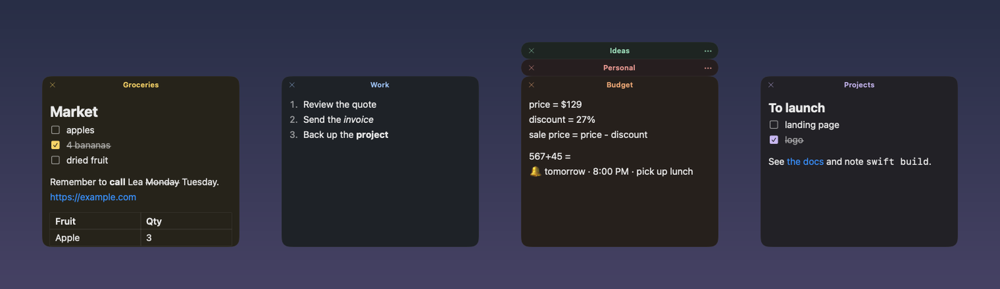

# mSTICK

[Français](README.fr.md)

## About

mSTICK is made by Starbudweiser & Claude Code (Anthropic). Part of the **DESKTOP MAC TOOLKIT**. MIT License, © 2026 Starbudweiser. Provided as is, without warranty. "About mSTICK" is in the app menu. It is inspired by Hold My Notes and is not affiliated with its authors.

Desktop notes you can stack, encrypted and always within reach.



## Features

- **Notes are real windows** on your desktop: dark by default (or light, or follow the system), a centered title, eight close-button styles (left or right), a color per note plus your own, float on top, glue to the desktop, show on all desktops. Markdown (bold, italic, underline, strikethrough, headings, bullets, numbered lists, checkboxes, links, tables) is styled live as you type.
- **Stacks**: drop a note onto another and they stack into one draggable unit; click a title bar to open that note; color the stack as a spectrum, unique colors or one color.
- **Fan** (⌥F): flip through your notes like a deck of cards, arrows or trackpad swipe, ⏎ to open, type to write a new note. **Peek** (⌥`): one key to bring the last note above any app, again to put it away.
- **Smart Calc**: `price = $129`, `discount = 27%`, `sale price = price - discount` shows `→ $94.17` beside the line; `567+45 =` fills in its result on Return.
- **Slash commands**: type `/` for a checklist, table, divider, date, reminder, float, glue, color and more (they insert Markdown).
- **Reminders** in plain language (English, French, Spanish, Italian): `remind me tomorrow at 8pm to pick up lunch`, then Return. The note opens when it is due.
- **Library and archive**: archive instead of deleting, search titles and text, multi-select, delete with a 10-second undo.
- **Export and import**: Markdown or plain text (one file per note), a single file, or a re-importable `.stickies` archive. Optional Markdown folder (for example an Obsidian vault) kept in sync.
- **Encrypted**: notes are encrypted on disk with AES-GCM, the key lives in your Keychain. No account, no server, no telemetry.
- **Optional sync** between your Macs through a folder (iCloud Drive by default), one `.hmnote` file per note.
- **Global shortcuts** (no Accessibility permission): new note ⌥⌘N, Fan ⌥F, Peek ⌥`, Library ⌥⌘L, hide everything ⌃⌥⌘H. All can be changed.
- **Light**: no background polling, one timer at most (the next reminder), nothing kept in memory while the Fan is closed.
- **Automatic updates** from GitHub releases, signature and notarization verified.
- **Four languages** (French, English, Spanish, Italian), picked from the system language.

## Requirements and installation

macOS 14 or later, Apple Silicon. Download the latest `mSTICK.zip` from the Releases page, unzip it and move mSTICK.app to Applications. The app is signed and notarized and updates itself from GitHub releases.

## Build

Requires macOS 14+ and Xcode (Swift 6).

```bash
swift test          # unit tests
./build_app.sh      # builds mSTICK.app, signs it and installs it
```

`NO_INSTALL=1 ./build_app.sh` builds `./mSTICK.app` without installing it. `mSTICK --selftest` checks the editor without opening any window. Notes are stored in `~/Library/Application Support/mSTICK` (`MSTICK_DATA_DIR` to change it).

## Support / Soutenir

This app is free. If it is useful to you, you can support the project (optional, no reward expected): [GitHub Sponsors](https://github.com/sponsors/starbudweiser).

Cette appli est gratuite. Si elle vous est utile, vous pouvez soutenir le projet (facultatif, sans contrepartie) : [GitHub Sponsors](https://github.com/sponsors/starbudweiser).
